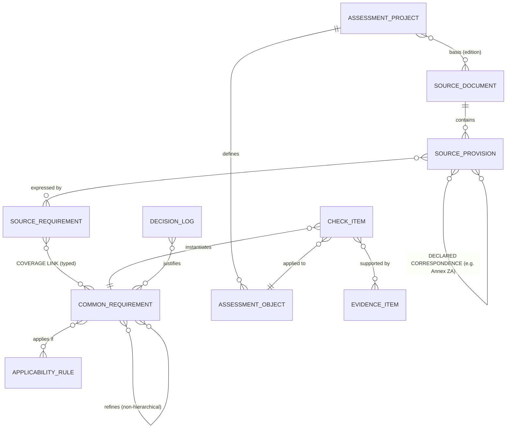

# Compliance Traceability & Assessment Methodology — Specification

| | |
|---|---|
| **Version** | 0.3.9 (decisions as ADRs in the project repository; checkpoint reports moved there) |
| **Date** | 25 October 2026 |
| **Project** | Functional Safety & AI — assessment of AI systems under the Machinery Regulation (EU) 2023/1230 |
| **Status** | Draft. Method, data model and roadmap. Phase 1 implemented and tested. Phase 2 in progress: legal backbone (MR complete for manufacturers + AIA) ISO/IEC CD TS 22440-1 and ISO/IEC TR 5469 built and checked as private packs; all common requirements in the public master list (§ 8.3); refinements between standards and law typed (full / partly), full refinements substitute the legal requirement in projects. prEN 18228 next. Decisions: ADRs in the project repository, mapped in § 10. |
| **Predecessor** | `MR_AIA_Traceability_Step1.xlsx` (MR Annex III ↔ AI Act matrix, 8 Oct 2026) |

### Change log

| Version | Date | Changes |
|---|---|---|
| 0.1 | 9 Oct 2026 | First draft |
| 0.2 | 9 Oct 2026 | Verdicts renamed Pass/Fail; N/A and exclusions moved to the applicability field; new value *Not in scope (agreed)*, which must be disclosed in reports (§ 4.8, § 5.6). Finding severity confirmed. Register rule for all category strings: single source of truth (§ 6.3, § 8.1). CTRL/PROT removed as domains and turned into system-type scoping tags; new domain FS; MECH renamed PHYS (§ 4.6, § 6.2). MR classification and AI system category merged into one list (§ 4.6). *Guidance* is now a catalogue attribute for assessors; `project_interpretation` removed (§ 4.5, § 4.8). Catalogue governance: author only (§ 4.11, § 5.1). Open decisions closed (§ 10). |
| 0.3 | 9 Oct 2026 | New § 12 Roadmap with one-source-at-a-time onboarding and a checkpoint after each source. New rule A10 (ingestion scope: list every provision, atomise only in-scope ones). Phase 1 implementation rules: CI ID `<object>/<CR>` (§ 4.8, § 6.1), parent CRs are rolled up and not assessed (§ 4.5), rule language and implemented tag names (§ 4.6), evidence citation (§ 4.9), full roll-up status set and precedence (§ 5.6), register naming (§ 6.3), workbooks and scripts (§ 8.1). |
| 0.3.1 | 9 Oct 2026 | Phase 2 step 1. New SP role *Not applicable (catalogue)*: provisions that cannot apply to products in catalogue scope; they roll up as *No requirement* (§ 4.3). Orphan check counts only counting links (§ 8.1). Proposed (pending confirmation): `MR-AIDA` not populated; AIA provisions act as proxy until the delegated act is adopted (§ 5.3). |
| 0.3.2 | 9 Oct 2026 | Catalogue stored as JSON (single source of truth), defined by one Python data model; the catalogue workbook is generated and read-only (§ 8.1). Source text and our judgements are kept apart: raw text per source, amendments (Omnibus) applied at load time, derived file per source with provision annotations, SRs and their links (§ 8.1). Coverage links are identified by (SR, CR); `L<nnnn>` IDs are generated at export (§ 6.1). |
| 0.3.3 | 9 Oct 2026 | Phase 2 step 1b: MR completed (Arts 1–3, 6–11, 17–25, 52, 54; Annexes I–X). New CR domain CONF (§ 6.2). Rule A10 clarified for legal acts: parts addressed only to other actors may stay unlisted if the ingestion scope is logged (§ 5.1). One amending-act file per amended document; corrigenda are modelled as amending acts (§ 8.1). Alternative conformity routes modelled as an OR group with rules (§ 4.5). Roadmap updated (§ 12). New scoping tags `prod.type`, `conf.module`, `ifu.digital`, `use.non_professional` (§ 4.6). |
| 0.3.4 | 10 Oct 2026 | Phase 2 step 2: ISO/IEC CD TS 22440-1 onboarded. Refinements from standards are stand-alone CRs, not children of legal CRs (§ 4.5). Verbatim text of licensed drafts may be kept in raw.json as internal store; workbook exports omit it unless generated with `--internal` (§ 7, § 8.1). New domain TOOL (§ 6.2), new tag `dev.ai_tools`; `INT.AISC` used by measure rules (§ 4.6). SP depth limit raised to 6 (§ 8.1). Pilot: `INT.AISC = 3`, DEV object (§ 9). |
| 0.3.5 | 10 Oct 2026 | Refinements typed *Full* / *Partly* (register list `REFCOV`); full refinements substitute the refined leaf CR in projects that select them (§ 4.5, § 5.4, § 5.6, D0033). TS 22440-1 refinements recorded: 9 legal CRs fully, 36 partly refined; pilot checklist 266 → 257 CIs. § 10 turned into a decision register with status; open questions of the checkpoints P2-1, P2-1b and P2-2 recorded there (MR-AIDA proxy and other proposals accepted, § 5.3, § 9). |
| 0.3.6 | 17 Oct 2026 | Phase 2 step 3: ISO/IEC TR 5469:2024 onboarded with derived SRs (A8); the client draft checklist was re-granularised so that 62 % of the TR links land on existing MR/AIA/TS CRs (§ 5.1, checkpoint P2-3). One set of full refinements per CR; full refinements only where none exists yet; chained full refinements are warned (§ 4.5, D0036). New tags `AI.rl`, `dev.virtual_testing`; rule `AI.tech_class != I` (then `TS.SWTC`) for ML-specific TR CRs (§ 4.6). TE objects used for per-element classification (§ 4.7, § 9). Annex C requirement levels recorded as measure ratings (§ 5.1 A7/A8, D0037). New open task: combined checklist view (§ 10.2 D30, § 12 Phase 3). |
| 0.3.7 | 17 Oct 2026 | Repository split (§ 7, § 8.3, D0040): the public repository holds code, schemas, spec, the legal sources and the master list of all publishable CRs (the *core*); licensed sources are *packs* (private repository) with their raw and derived files, pack-own CRs, CR overlays and decisions. References point from a pack to the core only. New CR attribute `provenance`, *dormant* CRs (§ 4.5); CR overlays with source-conditional rules via the implicit tag `basis.<SD>` (§ 4.6, § 8.3). Neutral terminology in the public catalogue: tags `TS.AUL`/`TS.SWTC` renamed `AI.usage_level`/`AI.tech_class` (TR 5469 terms, D0042); TS 22440-1 wording, draft values and rating-derived rules moved to pack overlays, 24 CRs that mirror the draft's structure kept in the pack until publication (D0041). Pilot record moved to the private repository (§ 9). |
| 0.3.8 | 18 Oct 2026 | Master list and packs (§ 7, § 8.3, D0043): `catalogue/` is the public master list of **all** CRs (incl. the 24 former pack CRs, reworded, D0046) with the list of known packs; every source document is its own pack with the same format and loading for public and private packs (public: MR, AIA, MR-AIDA; private: TS22440-1, TR5469). CR overlays, pack-own CRs, `provenance`, dormant CRs and the implicit tag `basis.<SD>` removed. Source-specific applicability and guidance are attributes of the coverage link: `condition` (OR across the sources of the basis, nearest linked CR per source) and `guidance` (§ 4.5, § 5.4, D0044). Several full-refinement sets per CR (§ 4.5, D0045; closes D31). Unreached CRs are warned as orphans only when all known packs are loaded (§ 8.3). Standard terms and clause references may be used in CR text (§ 7). Pilot P26901 unchanged (302 CIs, 275 applicable, 12 substitutions, 4,384 statuses identical). |
| 0.3.9 | 25 Oct 2026 | Decisions D1–D38 moved to architecture decision records (ADR-0003 to ADR-0040) in the private project repository `compliance-traceability-project`; § 10 keeps the mapping, so that references in the catalogue data and in this document stay resolvable. Checkpoint reports moved there from `docs/` (§ 7). Catalogue decisions (D0001 ff.) unchanged. |

---

## 1 Purpose and scope

### 1.1 Goal

The goal is a single, reusable method that produces, for any assessment, a **checklist of atomic requirements**:
- each requirement can be reviewed against evidence and receives one verdict;
- each verdict traces back to the legal provisions, standard clauses or framework items it demonstrates;
- the result can be reported in the structure the client needs: per regulation, per harmonised standard or per standard clause.

### 1.2 Scope

- **Initial regulatory focus:** Machinery Regulation (EU) 2023/1230 (MR) and AI Act (EU) 2024/1689 (AIA), as amended by the Digital Omnibus on AI (EU) 2026/1744.
- **Initial technical focus:** AI systems that are safety components of machinery, or form part of such components.
- **Designed to extend to** any regulation, harmonised or non-harmonised standard, technical specification (TS), technical report (TR) or in-house framework.

### 1.3 Out of scope

- Legal advice. Interpretations are recorded as such (§ 4.11).
- Replacing a notified body's conformity assessment procedure. The method produces evidence and verdicts that can feed into such a procedure.

### 1.4 Regulatory context the model must accommodate (as of 9 Oct 2026)

| Fact | Consequence for the model |
|---|---|
| MR applies from 20 Jan 2027. Annex III already contains AI-relevant EHSRs (1.1.6 f/g, 1.1.9, 1.2.1, 3.2.4, 3.3 …). | MR Annex III is a binding source in its own right. |
| Reg. 2026/1744 moves the MR to AIA Annex I **Section B**. For machinery, AIA Chapter III does not apply directly (AIA Art 2(2) as amended). | The AIA is a *reference* source for machinery, not directly binding. |
| New MR Art 8, 3rd para: delegated acts will add AI-specific EHSRs to Annex III, reflecting AIA Ch. III Sec. 2 and Arts 17, 19, 72, 73. They apply **by 2 Aug 2028**. | The Step-1 "AIA addition" rows are placeholders for **anticipated** provisions. They are modelled as a source with status *anticipated*, to be replaced when the delegated act is adopted (§ 4.1). |
| New MR Art 20(10): until MR-specific AI standards exist, AIA harmonised standards (Arts 40/41) give presumption of conformity with Annex III "as regards high-risk AI systems". | Presumption reaches the MR in **two hops**: hEN clause → AIA article → MR Annex III (§ 5.3). |
| New AIA Art 6(1a)/(1b): non-safety uses are not safety components unless their failure endangers health and safety. | This is a classification input for scoping (§ 4.6). |

---

## 2 Assessment use cases

The same data structure serves all of the following. A use case is just a **selection of source documents** plus a reporting view.

| ID | Use case | Basis (selected sources) | What is assessed | Report structure | Presumption statement |
|---|---|---|---|---|---|
| **UC1a** | Compliance with regulation(s), assessed against the legal requirements directly | MR Annex III (+ anticipated AI EHSRs); AIA as reference | All common requirements linked to the selected legal source requirements | Per legal provision | None. Conformity is shown by direct assessment. |
| **UC1b** | Compliance with regulation(s), via harmonised standards | Selected hENs **plus** the legal provisions those hENs do not cover, or cover only partly | Common requirements linked to the hEN clauses, plus the residual legal common requirements | Per hEN clause, plus a residual section per legal provision | Only for hENs cited in the OJ on the report date, and only for the provisions listed as covered in their Annex ZA |
| **UC2** | Compliance with a specific standard (harmonised or not, incl. TS) | One standard (one edition) | Common requirements linked to that standard's source requirements | Per clause of the standard | None (or "conforms to [standard]" where the standard has a conformance clause) |
| **UC2-G** | Assessment against guidance (TR or framework) | One informative document plus the requirements we derived from it | As UC2. All items carry the obligation level *Derived* | Per clause of the guidance document | None. Report wording: "assessed against" (not "complies with") |

Several use cases can be combined in one project, e.g. UC1b plus UC2-G (TR 5469) for the pilot.

---

## 3 Design principles

| # | Principle | Rule |
|---|---|---|
| P1 | **Layer separation** | Source provisions are never assessed directly. Only *common requirements*, applied to a specific assessment object, receive verdicts. |
| P2 | **Source neutrality** | Every source (regulation, hEN, TS, TR, framework, in-house rule) is ingested through the same pipeline. No source is structurally privileged. |
| P3 | **Atomicity** | An atomic requirement is one that gets **one verdict from one review of evidence**, for one assessment object. Atomicity is defined by how it is verified, not by sentence count. |
| P4 | **Typed traceability** | Every link has a type, a rationale, an author and a review status. An untyped "relates to" is not allowed. |
| P5 | **Assess once, reuse** | Organisation-level requirements are assessed once per manufacturer. AI-performance requirements are assessed once per AI function, not once per EHSR they serve. |
| P6 | **Explicit acceptance criteria** | Every common requirement states what counts as "pass", and where that criterion comes from. |
| P7 | **Copyright-safe content** | Standard text is stored as a clause reference plus our own paraphrase. Verbatim text is kept only for public-domain law and only under licence for internal use (§ 7). |
| P8 | **Versioned and impact-analysable** | Links point to source *editions*. Catalogue releases are baselined, and projects are pinned to a baseline. |
| P9 | **Transparent interpretation** | Every merge, split, derived requirement, catalogue-level N/A and resolution of conflicting sources is logged with its rationale. |

---

## 4 Information model

### 4.1 Overview



The model has three layers:
- **Source layer:** source document, provision and source requirement. This is *what the texts say*.
- **Catalogue layer:** common requirements and their links. This is *what we assess*. It is shared across all projects.
- **Project layer:** project, assessment objects, check items and evidence. This is *one assessment*.

### 4.2 Source document (SD)

| Attribute | Values / notes |
|---|---|
| `sd_id` | Short code, e.g. `MR`, `AIA`, `OMN`, `MR-AIDA` (anticipated delegated act), `EN18228`, `TS22440-1`, `TR5469`, `ISO13849-1` |
| `title`, `edition` | Edition or version, e.g. `2023`, `CD 2026-xx`, `ENQ` |
| `doc_type` | Regulation · Delegated/implementing act · hEN · EN · ISO/IEC IS · TS · TR · Guidance · In-house framework |
| `lifecycle_status` | Anticipated · Draft (CD/DIS/ENQ/FprEN) · Published · Cited in OJ (date) · Withdrawn/superseded (date) |
| `normative_strength` | Binding law · Presumption-conferring (hEN cited in OJ) · Voluntary normative · Informative |
| `legal_link` | For hENs: the legislation and standardisation request named in Annex ZA (e.g. AIA, M/613) |
| `licence_class` | Public domain · Licensed (internal only) · Client-confidential |

### 4.3 Source provision (SP)

A provision is a unit in the source's **native structure**: article/paragraph/point, clause/sub-clause, table row or checklist line.

| Attribute | Values / notes |
|---|---|
| `sp_id` | `<sd_id>:<native ref>`, e.g. `MR:III-1.2.1-2(c)`, `AIA:9(2)(a)`, `TS22440-1:8.3.2.2`, `TR5469:9.3.3` |
| `parent_sp` | Gives the hierarchy (chapeau → points) |
| `role` | **Umbrella** (its verdict is rolled up from children) · **Atomic** · **Lead-in** (a chapeau with no content of its own) · **Definition** · **Scope/Applicability** · **Informative note/example** · **Measure table** · **Not applicable (catalogue)** (cannot apply to products in catalogue scope, e.g. biometric or financial-institution provisions; rolls up as *No requirement*; decision logged) |
| `text` | Verbatim (law) or `null` + paraphrase (copyrighted standard). See § 7. |
| `condition_text` | Applicability wording found in the text, e.g. "where laser equipment is used", "for autonomous mobile machinery" |

The Step-1 matrix rows map directly onto SPs (Annex A).

### 4.4 Source requirement (SR)

A source requirement is **one atomic obligation as one source states it**. It can be built from more than one provision. For example, the client checklist row "9.3.5-1 (with 9.4.1)" draws on two clauses.

| Attribute | Values / notes |
|---|---|
| `sr_id` | `SR.<sd_id>.<nnnn>` |
| `sp_refs` | One or more provisions |
| `statement` | Source wording (law) or paraphrase (standards) |
| `obligation` | **Shall** · **Should** · **May/Permission** · **Derived** (written by us from an informative source) |
| `origin` | Literal · Derived. For *Derived*: author, date and rationale are mandatory. |
| `parameters` | Integrity or classification parameters the source makes it depend on, e.g. `PL=d`, usage level `A1` |
| `measure_rating` | For measure tables: HR / R / – (and effectiveness, where given), per parameter value |

### 4.5 Common requirement (CR) — the assessment catalogue

| Attribute | Values / notes |
|---|---|
| `cr_id` | `CR.<domain>.<nnn>` (domains in § 6.2) |
| `title`, `statement` | Neutral wording ("The AI function …", "The provider …"). Not copied from any one source. |
| `parent_cr`, `decomposition` | Builds the hierarchy. `AND` = all applicable children required. `OR` = at least one child, with the choice justified. This captures alternatives such as MR 3.3.3 ¶6 (i)/(ii) or MR 1.3.8.2 (a)–(d), and the conformity assessment routes of MR Art 25 (CR.CONF.001.2: module A, B+C, H or G). In an OR group the children carry applicability rules where the law restricts the choice; the routes not chosen are set to *N/A – feature absent* in the project. |
| `refines` | Non-hierarchical refinements of other CRs, each with coverage *Full* or *Partly* (register list `REFCOV`) and, for full refinements, a `set` (usually the refining source); a complete set substitutes the refined leaf CR in projects (see *Non-hierarchical refinement* below) |
| `cr_type` | Design property · Verification/test · Document content · Process · Organisational · Information for use |
| `object_level` | Which assessment object it applies to: ORG · PRD · SF · AIF · TE · DEV (§ 4.7) |
| `verification_method` | Document review · Analysis/calculation · Test witnessing · Test-record review · Inspection · Interview · Process audit |
| `acceptance_criterion` | Generic pass criterion (= "PASS criteria" column of the current checklist), plus `criterion_source` (which SR or standard it comes from) |
| `assessor_guidance` | Catalogue-level help for assessors: how to assess, typical evidence, worked examples (= "Guidance" column of the current checklist). Maintained by the catalogue author, not filled in per project. |
| `expected_evidence` | Types of work product, e.g. ODD specification, HARA, data management plan, V&V report, IFU section |
| `lifecycle_phase` | For framework views (TR 5469 / TS 22440 phases, ISO/IEC 5338 stages) |
| `applicability_rule` | A rule over the scoping tags (§ 4.6) that holds whichever source requires the CR (e.g. `dev.ai_tools = yes`). Conditions that come from one source (rating tables, classes defined by a standard) are conditions on that source's coverage links (below). |
| `tension_flag` | Set when linked sources conflict (e.g. MR absolute wording vs AIA probabilistic thresholds). The resolution goes in the Decision log. |
| `status` | Draft · Released (included in a catalogue baseline) · Deprecated (with replacement) |

**Coverage link (SR → CR)** — the central traceability object:

| `link_type` | Meaning | Counts toward the SR's verdict? |
|---|---|---|
| **Covers** | This CR alone satisfies the SR (equivalent, or the CR is stricter) | Yes — sufficient |
| **Covers partly** | This CR satisfies part of the SR | Yes — together with the SR's other *Covers partly* links |
| **Supports – method** | The CR (usually from a standard) gives the method or acceptance criterion used to show the SR | No |
| **Supports – process** | The CR is a process that produces the evidence for the SR (e.g. "data management process exists" for "data sets are representative") | No |
| **Context** | Informative relationship | No |

Each SR carries `coverage_complete` (Y/N). The catalogue release check requires **Y for every in-scope SR**. A SR covered only partly with no further links is a **catalogue gap**.

A coverage link may also carry:

| Attribute | Meaning |
|---|---|
| `condition` | Applicability rule (§ 4.6) that applies only because of this source, e.g. a standard's rating table: `AI.usage_level = A1 AND INT.AISC in {2, 3}`. Empty = the source always requires the CR. Only counting links have conditions. |
| `guidance` | Assessor guidance that applies only because of this source (standard-specific terms, draft examples, ratings). Added to the guidance of the check items the link selects, prefixed `[<SD>]`. |

**Source-specific applicability (D0044).** In a project, a leaf CR is applicable if its own `applicability_rule` holds **and**, for at least one source of the basis, a condition of that source holds (OR across sources; a link without condition always holds). Per source, only the links on the **nearest linked CR** on the path from the leaf to its root count: a link on a parent applies to the descendants that the same source does not link themselves. So a source can link an umbrella CR without condition and its children with rated conditions (TS 22440-1 test methods, CR.VV.003.x). Example: CR.ODD.002 is required by TS 22440-1 only for rated classes (condition on the TS link) but by TR 5469 without condition; with both in the basis it is applicable whatever the rating, with only the TS it follows the rating.

**Refinement rule:** if a source states something more specific or stricter than an existing CR (e.g. a standard requires a specific performance class or a quantitative criterion), we create a **child CR**. The SR gets *Covers* on the child. The child *refines* the parent. A child CR passing satisfies its parent for that object, if the parent is OR-decomposed or this is the only applicable child. *Exception (D0026):* a refinement that comes from a standard while the parent comes from law is created as a **stand-alone CR**, because a project selects all descendants of a linked CR, and a standard's detail must not appear in projects whose basis does not include that standard. Children are used within one source family (e.g. the TS 22440-1 groups RM.017, DATA.003, PERF.004, VV.003).

**Non-hierarchical refinement (`refines`, D0026, D0033).** A stand-alone CR records the CRs it refines, each with a coverage:

| Coverage | Meaning | Effect in a project |
|---|---|---|
| **Full** | The *full* refinements of a CR with the same `set` **together** satisfy it completely. Residual aspects of the refined CR are written into the acceptance criteria of its full refinements, so nothing of the legal requirement is lost. | **Substitution:** a set is complete if all its members are selected (their source is in the basis) and each has at least one CI that is not N/A by rule. If a *leaf* CR has at least one complete set, it gets **no own CIs**. Its status is the combination (AND) of the members of all its complete sets; legal SRs and SPs roll up through it as before. Otherwise the refined CR is assessed normally. |
| **Partly** | The refinement adds detail to part of the refined CR (e.g. AI faults within the general hazard identification). | None: both are assessed; `V_CR` shows the relation so the assessor can use the same evidence. |

Effect: where a standard covers a legal requirement completely, the project checklist contains the standard's (more specific) check items only, and the legal provision is still reported (e.g. AIA Art 15(1) in `V_CL_AIA` lists the TS 22440-1 check items that substitute CR.PERF.001.1–3). The checker validates existence, self-reference, cycles and duplicates, and warns where a parent CR is fully refined (only leaves are substituted) or where a full refinement is chained (the refining CR or one of its descendants is itself fully refined; no substitution then). Limitation of the Excel roll-up: a substituted CR combines its refinements level by level (S0…Sn), which is exact as long as refinement depth + depth of the substituted CR ≤ 3.

**Refinement sets (D0045).** A CR may have several sets of full refinements, typically one per standard (`set` = the refining source, e.g. `TS22440-1`, `TR5469`). Each set must be complete on its own; a project with only one of the standards in its basis is substituted by that standard's set, a project with both by both. This replaces the one-set limitation of D0036 (§ 10.2 D31). In the catalogue workbook, column *Refines fully* shows the set in brackets (`CR.ROB.003 [TS22440-1]`).

**Parents are not assessed directly:** a CR that has children gets no check items of its own. Its status is rolled up from its children only (§ 5.6). Residual content of a parent is expressed as one more child.

### 4.6 Scoping vocabulary (applicability tags)

Tags and their allowed values are defined in the register (list `TAG`; each tag names the register list holding its values). Project tag values are entered in the project's `TAGS` sheet.

| Tag group | Tags (as used in rules) and values |
|---|---|
| **AI system category** (one list; combines MR classification and Step-2 category) | `AI.cat` ∈ {**A5** – safety component with fully or partially self-evolving behaviour (MR Annex I Part A item 5) · **A6** – machinery with embedded self-evolving safety system (Part A item 6) · **B15** – AI-based protective device detecting persons, not self-evolving (Part B item 15) · **B17** – AI-based logic unit for safety functions, not self-evolving (Part B item 17) · **SC** – other AI safety component, not in Part A/B (Annex II, MR Art 3(3), AIA Art 6(1b)) · **NSF** – AI not a safety function (AIA Art 6(1a)) · **NSF-SE** – AI not a safety function, self-evolving}. Final list to be confirmed in Phase 4. `AI.learning` ∈ {static, dynamic}. `AI.rl` ∈ {yes, no} — reinforcement learning or other reward-based optimisation used (TR 5469 8.4.3; CR.MODEL.006/007) |
| **AIA classification** (derived from `AI.cat`) | `AIA.high_risk_6_1` ∈ {yes, no, tbd} |
| **AI classification** (usage level and technology class as defined in TR 5469 6.2) | `AI.usage_level` ∈ {A1, A2, B1, B2, C, D}; `AI.tech_class` ∈ {I, II, III} (renamed from `TS.AUL` / `TS.SWTC`, D0042). The TR 5469 links to CRs that address data-driven (Class II) technology carry the condition `AI.tech_class != I`. |
| **Integrity level** | `INT.PL` ∈ {a…e}; `INT.SIL` ∈ {1…3}; `INT.AISC` ∈ {1…3} (required systematic capability of the AI part, on the scale of the applied AI standard). Conditions derived from the measure ratings of an AI standard combine `AI.usage_level` and `INT.AISC`, e.g. `AI.usage_level = A1 AND INT.AISC in {2, 3}`; they are conditions on that standard's coverage links (§ 4.5), not CR rules. |
| **System types** (the AI system is, or is part of …) | `sys.control_system`, `sys.protective_device`, `sys.guard_interlock`, `sys.remote_control`, `sys.wireless_control`, `sys.supervisory_function` (MR 3.2.4), `sys.hmi` — each ∈ {yes, no}. These replace the former domains CTRL and PROT. |
| **Machine features** | `feat.mobile`, `feat.autonomous_mobile`, `feat.lifting`, `feat.lifting_persons` ∈ {yes, no}; further features from MR Annex III chapters 2–6 added when needed |
| **Product** | `prod.type` ∈ {machinery, related-product, PCM} (MR Art 3(1), 2(1)(a)–(e), 3(10)); reserved for partly completed machinery, atomised in Phase 5 |
| **Conformity assessment** | `conf.module` ∈ {A, B+C, H, G} — route chosen under MR Art 25; selects one child of the OR group CR.CONF.001.2 and CR.CHG.007 (B+C, H). Whether the route is permitted for the classification is an acceptance criterion, not a rule, so a wrong choice is reported as Fail |
| **Information for use** | `ifu.digital`, `use.non_professional` ∈ {yes, no} (MR Art 10(7)) |
| **Development** | `dev.ai_tools` ∈ {yes, no} — AI-based software tools are used to develop the safety-related product (CR.TOOL.001). `dev.virtual_testing` ∈ {yes, no} — virtual test results (simulation, digital twin, MIL/SIL/HIL) are used in the safety argument (TR 5469 9.4.2; CR.VV.009) |
| **Organisation** | `org.size` ∈ {SME, SMC, Large} |
| **Scope options** | `scope.FR` ∈ {yes, no} — include fundamental-rights requirements (default no, D5) |
| **Hazard presence** | Not a tag in v1: handled per check item in scoping stage S3 (*N/A – hazard absent*, with risk-assessment reference) |

**Rule language** (`applicability_rule`):

```
rule    := TRUE | FALSE | expr                       (empty rule = TRUE)
expr    := term { OR term }
term    := factor { AND factor }
factor  := NOT factor | ( expr ) | tag = value | tag != value | tag in {v1, v2, …}
```

Example: `sys.control_system = yes OR sys.protective_device = yes`.

Coverage-link conditions (§ 4.5) use the same language.

Evaluation is three-valued. A rule is **undetermined** if a tag it needs is unset or `tbd`. The check item is then proposed as *Applicable*, with the note "assessor to confirm". The checker validates the syntax, tags and values of every rule and link condition against the register.

### 4.7 Assessment project and assessment objects

| Object level | Code | Pilot example |
|---|---|---|
| Organisation (manufacturer/provider) | ORG | Manufacturer's QMS, PMM, incident process |
| Product (machine, or safety component placed on the market) | PRD | Camera-based protective device |
| Safety function | SF | SF-01: detect person in protective field → slow down; SF-02: … → stop |
| AI function / AI component | AIF | AIF-01: CNN person detector |
| Technology element (TR 5469 7.1 / TS 22440 5.2) | TE | TE-01 trained detector (Class II); TE-02 inference software stack (Class I); TE-03 inference hardware (Class I). One TE object per group of elements of the same class; check items CR.GEN.006.1/.2 |
| Development process / toolchain | DEV | Data pipeline, training, labelling, simulation toolchain |

The project record holds: client, product, use case(s), selected SD editions, catalogue baseline, tag values, a **boundary statement** (what is inside the object of assessment and what is inherited from the host machine or the organisation), a list of **agreed exclusions** (each with an agreement reference, e.g. offer or contract clause), and the list of objects.

### 4.8 Check item (CI) — one checklist line

**CI = CR × assessment object, within a project.** The fields keep the current client checklist workflow (TR 5469 checklist columns). *Applicability* (does this item have to be assessed?) and *verdict* (what was the result?) are separate fields:

| Field | Filled by | Notes |
|---|---|---|
| `ci_id`, `cr_id`, `object_id` | system | `ci_id = <object_id>/<cr_id>`: stable across rebuilds |
| `rule_applicability` | system | Applicability proposed by the CR's rule from the project tags. If the assessor's `applicability` differs, it is treated as a manual override and kept on rebuild. |
| `applicability` | assessor | **Applicable** · **N/A – feature absent** · **N/A – hazard absent** (with RA reference) · **Inherited** (assessed elsewhere: ORG-level CI, host-machine DoC, supplier certificate) · **Not in scope (agreed)** (deliberately not assessed, by agreement with the client, e.g. out of the agreed boundary) |
| `applicability_justification` | assessor | Mandatory for every value other than Applicable. For *Not in scope*: the agreement reference. |
| `evidence_refs` | client | Evidence IDs from the EV register, each with a section or page pointer, e.g. `P26001-EV-002 §4` |
| `client_statement` | client | Compliance statement |
| `assessor_remarks` | assessor | |
| `verdict` | assessor | **Pass · Fail · Info needed · Pending**. Only for Applicable items; empty otherwise. |
| `finding_severity` | assessor | **Major · Minor** for Fail. **Observation** can also be raised on a Pass (improvement potential, no nonconformity). |
| `reviewer_remarks`, `reviewer_signoff` | reviewer | Four-eyes principle on assessments |

Partial verdicts are deliberately not allowed at CI level: an atomic item passes or fails. "Partial" exists only at roll-up level (§ 5.6).

**N/A vs. Not in scope:** N/A means the requirement does not apply to the product (feature or hazard absent), so nothing is left open. *Not in scope* means the requirement may apply but was deliberately not assessed. It is therefore always disclosed in the conformity report and qualifies the overall statement (§ 5.6).

**Status (derived, for views):** `= verdict` if Applicable, otherwise `= applicability`. Reports and dashboards count this one column.

### 4.9 Evidence item (EV)

`ev_id`, title, client document ID, version/date, work-product type, owner, confidentiality, storage location. Links EV ↔ CI are many-to-many. In v1 they are recorded in the CI field `evidence_refs`, which cites EV IDs (fixed-width numbering, so `EV-001` never matches `EV-0010`) plus a section pointer. The EV sheet counts how many CIs cite each document. One document typically supports many CIs, so the client sees one evidence request per document, not one per CI.

### 4.10 Declared correspondence (SP ↔ SP)

This stores claims **made by a source document itself**, chiefly the Annex ZA tables of hENs (e.g. prEN 18228 Table ZA.1: clause sets → AIA Art 9 paragraphs, "Covered"). Attributes: claimant SD, the two SPs, the declared coverage (Covered / Partially covered + remark), and the SD status that makes the claim valid (cited in OJ).

Declared correspondences are **authoritative inputs for the presumption statement (UC1b)**. They are kept separate from our own CR-based links. A consistency check compares the two (§ 5.3).

### 4.11 Decision log (interpretation register)

Every catalogue-level decision is logged: merge, split, derived SR, link type chosen, refinement, catalogue-level N/A, conflict resolution, and acceptance-criterion choice. Each entry records ID, date, author, affected SR/CR, rationale and source references (governance: author only, D4). This makes the catalogue defensible in front of a notified body or a market surveillance authority.

---

## 5 Processes

### 5.1 Source ingestion and atomisation

1. **Register** the SD (edition, status, licence class).
2. **Extract provisions** in their native structure. Assign each provision a `role`.
3. **Atomise** each provision into SRs using these rules:

| Rule | Description |
|---|---|
| A1 | **One verdict from one review of evidence.** Split if parts need different evidence, different assessment objects or different points in time (pre-market vs post-market). |
| A2 | **Trigger conditions:** split only if they are verified separately. Otherwise list them as test conditions inside one SR/CR (e.g. "no unexpected start: (i) on control fault, (ii) on power or network loss/restoration" — MR 1.2.1 ¶4(a) + 1.2.6 ¶2(a)). |
| A3 | **Lead-ins** produce no SR. Their conditions ("where appropriate", "for X machinery") pass down to the children as applicability. |
| A4 | **Umbrella provisions** produce no SR of their own unless they contain residual content beyond their children. If so, add a single "residual" SR (e.g. "no other hazardous situation identified in the control system FMEA"). |
| A5 | **Definitions** go to a glossary with cross-source term alignment (e.g. MR "intended use" ↔ AIA "intended purpose"). |
| A6 | **Content lists** (IFU contents, technical documentation, Annex IV): one SR per content element. In CRs they are grouped by document. |
| A7 | **Measure tables** (measure tables of AI standards, IEC 61508-style tables): one SR "select and apply measures according to [parameter]", plus one SR per measure carrying its rating (HR/R/–) by parameter value. Rule: an HR measure that is not applied needs a documented justification. Informative interpretation tables (TR 5469 Annex A) are grouped: one SR per group of tables with the same interpretation, plus one SR per table with AI-specific rows. Graded measure lists without parameters (TR 5469 Annex C: low/middle/high) give one SR per list with the grades in `measure_rating`; the grades add depth and do not switch requirements on or off, so they produce no rule (D0037). |
| A8 | **Informative sources (TR, guidance):** SRs are *Derived*. Their author and rationale are mandatory. The clause reference stays the anchor. Practice (TR 5469, D0035): one SR per separately verifiable consideration, linked first to existing CRs; new CRs only for source-specific methods. Where a client checklist exists, its item number is kept in the SR `notes`, and its PASS criteria and guidance go into the new CRs. |
| A9 | **Draft sources (CD, ENQ):** ingested with status *Draft*. Re-ingest at each new stage and run an impact analysis (§ 5.7). |
| A10 | **Ingestion scope:** list **every** provision of a source as an SP, so its coverage stays visible. Atomise only the provisions within the catalogue's scope. The others get `in catalogue scope = no` plus a scope note; they roll up as *Out of catalogue scope*. Log the scope decision. *Legal acts:* whole articles or annexes addressed only to other actors (Member States, notified bodies, market surveillance, other economic operators) may stay unlisted, because they would all be *Not applicable (catalogue)*; the ingestion scope is then logged and stated in the SD notes (MR: D0014). |

4. **Release:** the author runs the checker (`check_catalogue.py`), checks the atomisation against rules A1–A10 and releases it into the next catalogue baseline (author-only governance, D4). The four-eyes principle applies to assessments (§ 5.5), not to the catalogue.

### 5.2 Harmonisation (SR → CR)

For each SR:
1. Search the catalogue for CRs with the same subject, object level and property.
2. Choose the link type (§ 4.5). If the SR is stricter or more specific than an existing CR, create a **child CR**.
3. If nothing fits, create a new CR with neutral wording.
4. Set `coverage_complete`.
5. Log non-trivial decisions.

**Rule of thumb:** a regulation usually produces parent CRs (objectives). Standards and frameworks usually produce children (means, methods and criteria).

### 5.3 Bridging regulations and standards (UC1b)

1. Ingest each hEN's Annex ZA as **declared correspondences** (§ 4.10), at the native granularity (clause set → article paragraph).
2. Derive our own correspondence through the CRs: hEN SR → CR ← legal SR.
3. **Consistency check:** flag where Annex ZA claims "Covered" but our CR links show partial coverage, or the reverse. Discrepancies go to the Decision log. Annex ZA prevails for the *presumption statement*; our analysis prevails for the *gap list*.
4. **Two-hop presumption for machinery:** AIA hEN clause →(Annex ZA)→ AIA article →(MR Art 20(10), MR Art 8 3rd para)→ MR Annex III AI EHSR. Until the delegated act is adopted, the target is the *anticipated* source `MR-AIDA`. *Accepted (D0003, D0017):* `MR-AIDA` stays empty and the AIA provisions themselves serve as proxy in project bases; the legal-bridge correspondence is recorded when the delegated act is ingested. MR Art 8 ¶3 (Omnibus) requires the delegated act to reflect exactly the AIA provisions in the catalogue. The bridge AIA article ↔ MR-AIDA provision is a declared correspondence whose claimant is "MR Art 20(10)".
5. **Residual set** = legal SRs in the basis with no Annex ZA coverage, or only partial coverage. These are assessed directly against their CRs.

### 5.4 Scoping (per project)

| Stage | Input | Output |
|---|---|---|
| S0 Boundary | Product description, supply scope, offer/contract | Boundary statement; agreed exclusions; list of assessment objects (§ 4.7) |
| S1 Classification | MR Annex I/II, AIA Art 6, usage level and technology class (TR 5469 6.2, TS 22440), integrity level | Tag values (§ 4.6) |
| S2 Rule filter | Tags × `applicability_rule` × link conditions of the basis | One CI per leaf CR × object of the CR's level, pre-set to *Applicable*, *N/A – feature absent* (rule not met) or *Applicable – to confirm* (rule undetermined). The CRs are those linked (counting links) to source requirements of the project basis, plus their ancestors and descendants. The effective rule is the CR rule AND the OR of the link conditions of the basis sources (§ 4.5); it is quoted in the justification of N/A items. Leaf CRs substituted by a complete refinement set get no CIs (§ 4.5). |
| S3 Hazard filter | Client's risk assessment (hazard list) | N/A – hazard absent, with RA reference |
| S4 Inheritance & exclusions | ORG-level assessments already done; host-machine DoC; supplier certificates; agreed exclusions | Inherited CIs and *Not in scope (agreed)* CIs, with references |
| S5 Confirmation | Reviewer | Frozen applicable checklist (the project's starting point) |

### 5.5 Assessment execution

1. Issue the evidence request list, grouped by **expected work product** (not by CI).
2. The client links evidence and writes compliance statements.
3. The assessor assesses using the CR's acceptance criterion and `assessor_guidance`, and records remarks, verdict and finding severity. *Info needed* goes back to the client.
4. The reviewer signs off.
5. Findings are tracked to closure.

### 5.6 Roll-up and reporting

**Roll-up statuses** (register list `ROLLUP`), in order of precedence when items are combined:

| Precedence | Status | Arises from |
|---|---|---|
| 1 | **Fail** | A CI with verdict Fail |
| 2 | **Gap** | SR with `coverage complete = no` or no counting link; atomic SP in catalogue scope without SR |
| 3 | **Not assessed** | A CI that is *Not in scope (agreed)*. *Out of catalogue scope* SPs rank here too. |
| 4 | **Open** | A CI that is *Info needed* or *Pending* |
| 5 | **Pass** | A CI that is Pass, or *Inherited* (with reference) |
| 6 | **N/A** | A CI that is *N/A – feature absent / hazard absent* |
| — | *Not instantiated* | CR with no assessment object of its level in the project (not counted) |
| — | *No requirement* | SP with role Definition / Scope / Informative, or an umbrella with nothing below it (not counted) |

**Combining:** the highest-precedence status among the counted items wins. If nothing is counted, the item keeps its own base status (e.g. *Not instantiated*).

| Level | Rule |
|---|---|
| CI | Derived status = verdict if Applicable (empty verdict = Pending), otherwise the applicability value |
| Leaf CR | Combine its CIs (across all objects). A **substituted** leaf CR (§ 4.5) has no CIs and combines its full refinements instead. |
| Parent CR | AND: combine children. OR: Pass if at least one child is Pass (and no own Fail), otherwise as AND. Parents have no own CIs (§ 4.5). |
| SR | Gap if `coverage complete ≠ yes` or no counting link; otherwise combine the CRs linked by *Covers* / *Covers partly*. Supporting links are ignored. |
| SP | Role attribute from the register: *none* → No requirement; out of catalogue scope → Out of catalogue scope; otherwise combine own SRs + child SPs (atomic without SR → Gap) |
| SD / basis | Counts per status (V_SUMMARY) |
| Presumption | *Annex ZA*: claimable only if the claimant hEN is *Cited in OJ* **and** the claimant clause rolls up to Pass. *Legal bridge*: claimable if the source provision rolls up to Pass. |
| Disclosure | Every CI marked *Not in scope (agreed)* is listed in the conformity report with its agreement reference (V_EXCLUSIONS). Every provision rolling up to *Not assessed* is named in the qualified conformity statement. |

**Report views** (all generated from the same data):
1. Per legal provision (UC1a).
2. Per hEN clause plus residual legal provisions (UC1b).
3. Per clause of the standard (UC2 / UC2-G), e.g. a TR 5469 checklist in its familiar clause order.
4. Per lifecycle phase or framework activity (TS 22440 / TR 5469 / ISO/IEC 5338).
5. Per evidence document (client-facing).
6. Gap and finding register.
7. Exclusions register (*Not in scope* items, for the conformity report).

### 5.7 Change management

- **Catalogue baselines:** release version `CAT-yyyy.n`. Projects are pinned to a baseline and migrated only by explicit decision.
- **Source change** (new edition, new draft stage, OJ citation or withdrawal, adoption of the MR delegated act): the system computes the difference at SP level and lists the affected SRs, CRs and open projects. The impact assessment is recorded in the Decision log.
- **Adoption of the MR delegated act:** the anticipated source `MR-AIDA` is replaced by the adopted one. The existing CRs are kept, and only the coverage links are re-pointed. This is the main payoff of the layered model.

---

## 6 Catalogue structure and conventions

### 6.1 ID conventions

| Object | Pattern | Example |
|---|---|---|
| Source document | short code | `TS22440-1` |
| Source provision | `<SD>:<native ref>` | `MR:III-3.3.3-6(ii)` |
| Source requirement | `SR.<SD>.<nnnn>` | `SR.TR5469.0031` |
| Common requirement | `CR.<DOMAIN>.<nnn>[.<n>]` (child suffix) | `CR.PERF.004.2` |
| Project / object / evidence | `P<yy><nnn>` / `<P>-<LEVEL>-<nn>` / `<P>-EV-<nnn>` (fixed width) | `P26001-AIF-01`, `P26001-EV-002` |
| Check item | `<object_id>/<cr_id>` | `P26001-AIF-01/CR.PERF.004.2` |

| Coverage link / correspondence / decision | (SR, CR) pair, shown as `L<nnnn>` (generated at export, catalogue order) / `C<nnnn>` / `D<nnnn>` | `L0017` |
| Pack | SD ID of its source document | `TS22440-1` |

All CRs are in the master list. Decision and correspondence IDs are unique across the master list and all packs (one sequence each); the loader rejects duplicates. New CRs are numbered by the catalogue author, who has both repositories (D4).

### 6.2 CR domains

Domains group requirements by **concern** (what property is required). They are not grouped by **system type** (what kind of thing it is). System types such as control systems or protective devices are scoping tags (§ 4.6). For example, "no unexpected start after power restoration" belongs to domain FS and applies if `sys.control_system = yes`.

| Code | Domain | Code | Domain |
|---|---|---|---|
| GEN | Scope, classification, boundary | SEC | Cybersecurity & protection against corruption |
| RM | Risk management | FS | Safety-function behaviour & integrity (start, stop, fault reaction, response time, safe state, integrity level) |
| ODD | Operational design domain & specification | | |
| DATA | Data & data governance | HO | Human oversight & HMI |
| MODEL | Model selection, creation, optimisation, explainability | LOG | Logging & traceability |
| PERF | Performance, accuracy, uncertainty | CHG | Learning, change & modification management |
| ROB | Robustness, fault control, architecture | VV | Verification, validation & testing |
| INFO | Information for use, marking, warnings | TD | Technical documentation |
| QMS | Quality management | PMM | Post-market monitoring |
| INC | Incidents & corrective action | PHYS | Physical hazards: mechanical, electrical, thermal, noise, vibration, radiation … (mostly Inherited or Not in scope for AI components) |
| CONF | Conformity assessment, declaration & marking: Annex I classification, module route, notified body, EU declaration of conformity, CE marking, production conformity | TOOL | AI-based development tools: definition, impact class, fault analysis, confidence level, qualification (TS 22440-1 Annex C) |

### 6.3 Controlled vocabularies — register rule (single source of truth)

All enumerations in § 4 (verdicts, applicability values, link types, roles, domains, tags, severities, statuses …) are defined **once**, in a register.

| Rule | Description |
|---|---|
| V1 | Each register entry has a list name, a stable **key** (used in IDs and logic, never changed), a display **label** (may be edited), a sort order, an optional colour, and a description. |
| V2 | Drop-down validation references the register list (named range), never a typed-in list. |
| V3 | Formulas and conditional formatting reference register **cells** (named cells `<LIST>_<KEY>`, e.g. `VERDICT_PASS`, `APPL_NIS`, `ROLLUP_GAP`), never string literals such as `"Pass"`. Renaming a label then updates every formula, rule and drop-down at once (verified by the Phase-1 test). |
| V4 | Scripts that generate sheets read their vocabularies from the register. |
| V5 | Retiring a value: mark it deprecated in the register (keep the key), migrate existing uses, then hide it from drop-downs. |
| V6 | Behaviour attached to a value is stored as a register **attribute**, not coded in formulas: link types (`Attribute = yes` → counts toward coverage), SP roles (`own` / `children` / `none`), tags (name of their value list). |

**REGISTER layout:** one row per entry, lists in contiguous blocks, with columns List · Key · Label · Order · Colour · Attribute · Description · Deprecated.
- **Defined names:** `L_<LIST>` (label range, for drop-downs), `<LIST>_<KEY>` (single label cell), and `REG_LIST` / `REG_KEY` / `REG_LABEL` / `REG_ATTR` (whole columns, for attribute look-ups).
- **Adding an entry:** insert the row *inside* its list block, so the named range expands.
- **Colours:** conditional-formatting colours are taken from the Colour column when sheets are generated. Re-run the build after changing a colour.

Free text is limited to statements, guidance, rationale and remarks.

*Note:* the Step-1 workbook still hard-codes category strings in its formulas. It will be rebuilt to this rule when it is migrated into the model.

---

## 7 Copyright and confidentiality

| Content | Stored in the shared catalogue | Stored internally under licence | In client deliverables |
|---|---|---|---|
| EU law (MR, AIA, Omnibus) | Verbatim | Verbatim | Verbatim |
| Published or draft standards (ISO, IEC, CEN-CENELEC) | CRs: our own wording, may use the standard's terms (e.g. SIL, usage level, technology class) and clause references, but not its sentences, values or tables. SRs, link conditions and link guidance: only in the private pack | Verbatim in `sources/<SD>/raw.json` (internal JSON store, D0025); in a workbook only when generated with `make_catalogue.py --internal` | Clause reference + paraphrase |
| Requirements we derived from informative sources | Full text (our work) | — | Full text |
| Client evidence and project records | No | Project store only | That client only |

Draft standards (CD, ENQ) are confidential committee documents. Their content is used only internally until publication.

**Repositories (D0043).** Two repositories implement this table:

| Repository | Content | Access |
|---|---|---|
| Public (`compliance-traceability`) | Code, schemas, spec, test fixtures; the **master list** (`catalogue/`: all CRs, catalogue-wide decisions, the list of known packs); the **public packs** of EU law (`packs/MR`, `packs/AIA`, `packs/MR-AIDA`) | Public (MIT licence) |
| Project (`compliance-traceability-project`) | Decisions (ADRs, formerly § 10), checkpoint reports, iterations and the project's working agreements | Private |
| Private (`compliance-traceability-private`) | **Private packs** of licensed sources (`packs/TS22440-1`, `packs/TR5469`; later `packs/EN18228`): verbatim `raw.json`, `derived.json` (annotations, SRs, coverage links with conditions and guidance, correspondences), pack decisions; project records; generated workbooks that include pack content | Users covered by the licences |

Rules for the public part: all leaf requirements are public CRs (project-owner decision 18 Oct 2026, D0046); their text is our own and must not replicate the wording of a licensed source closely (checked by `test_public_text_not_verbatim` in the private repository: no run of 8 words shared with the raw text of a private pack). Terms defined in standards and clause references are allowed. SRs, link conditions and guidance of licensed sources stay in their pack; without the pack, the master list shows the requirements but not which source they give compliance against. The list of known packs (IDs and titles) is public. A workbook generated with private packs loaded is as confidential as the packs. Whether a licence permits sharing a pack with several users must be checked per licence; if not, each user can rebuild `raw.json` from an own copy with the onboarding scripts (open, § 10.2 D36).

**Committee drafts.** The public CRs created from ISO/IEC CD TS 22440-1 (e.g. the test-method group CR.VV.003) reflect the structure of a confidential draft, although the wording is ours; publishing them is a project-owner decision (18 Oct 2026, D0046).

---

## 8 Implementation

### 8.1 Version 1: JSON catalogue, Excel workbooks and scripts

**Catalogue store (single source of truth).** The catalogue is a set of directories of JSON files: the master list and one pack per source document (§ 8.3). One Python data model (`ctm/model.py`, pydantic) defines every file, and JSON Schemas generated from it (`schemas/`) give editor validation. New sources (standards) are added as new packs without touching the others:

| File | Content |
|---|---|
| `catalogue/catalogue.json` | Master list manifest: baseline ID, known packs in catalogue order (public packs with their default path) |
| `catalogue/common_requirements.json` | All CRs |
| `catalogue/decisions.json` | Catalogue-wide decision log (§ 4.11) |
| `packs/<PACK>/pack.json` | Pack manifest: pack ID, sources, amending acts (applied in order), required packs |
| `packs/<PACK>/sources/<SD>/raw.json` | *What the text says:* provisions in their native structure (ref, parent, heading, text). Verbatim law; references and headings only for licensed standards (§ 7). A provision whose text is not the official wording is flagged `verbatim: false`. |
| `packs/<PACK>/sources/<ACT>/raw.json` | Amending act: replace / insert / delete operations on **one** raw document of the same pack. They are applied when the catalogue is loaded, in manifest order, so the consolidated text is never stored twice. An act that amends several documents gets one file per document (Omnibus: `OMN` → AIA, `OMN-MR` → MR). Corrigenda are amending acts too (`MR-COR`). The SP records which act changed it (`amended by`). |
| `packs/<PACK>/sources/<SD>/derived.json` | *Our work on that source:* the SD record; one annotation per provision (role, in catalogue scope, scope note, short label, condition text; rule A10); the SRs, each with its coverage links to CRs of the master list (with optional condition and guidance, § 4.5); and the declared correspondences (§ 4.10) claimed by this source. |
| `packs/<PACK>/decisions.json` | Optional: decisions specific to the pack's source |

The SP ID is `<SD>:<ref>`. Enumerated fields store register **keys** (§ 6.3, V1); labels appear only in the workbooks. Applicability rules and project tags use the rule vocabulary (§ 4.6). Project seeds (`projects/<P>.json`) pre-fill a new project workbook.

**Two kinds of workbook:**

| Workbook | Sheets | Edited by |
|---|---|---|
| **Catalogue** (generated from the JSON, read-only) | `README`, `REGISTER`, `SD`, `SP`, `SR`, `CR`, `LINK_SR_CR`, `CORR`, `DECISIONS`. Each sheet has grey `chk:` formula columns (references exist, link counts). | Nobody: change the JSON and regenerate |
| **Project** (one per assessment) | Inputs: `PRJ`, `BASIS`, `TAGS`, `OBJECTS`, `EV`. Checklist: `CI` (colour-coded by actor). Views: `V_SUMMARY`, `V_FINDINGS`, `V_EXCLUSIONS`, `V_CL_<SD>` (checklist in a source's clause order), `V_SP`, `V_SR`, `V_LINK`, `V_CR`, `V_PRESUMPTION`. Baseline: `cat_*` sheets (read-only catalogue snapshot = pinned baseline) and `REGISTER` (copy). | Assessor, client, reviewer (input columns only) |

**Scripts** (Python 3 + openpyxl + pydantic; toolkit `ctm/`):

| Script | Purpose |
|---|---|
| `check_catalogue.py CAT_DIR [--pack DIR …] [--public-only \| --no-packs] [--fmt]` | Release check: schema validation of every file (required fields, register keys, ID patterns), every provision annotated (A10), amendment targets, references, SR placement, duplicate links, depth/cycles, rules and link conditions, coverage completeness, derived-SR rationale, atomic SPs without SR, pack rules (§ 8.3). `--fmt` rewrites the files of the master list and the loaded packs in canonical form. |
| `make_catalogue.py CAT_DIR OUT.xlsx [--internal] [--pack DIR …] [--public-only \| --no-packs]` | Generate the catalogue workbook with register, drop-downs and check columns. Text of licensed sources is omitted unless `--internal` is given (assessor reference only, never for clients) |
| `build_project.py CAT.xlsx PRJ.xlsx --init [--seed P.json]` | Create the project input sheets (tags pre-listed from the register; optionally pre-filled from a project seed) |
| `build_project.py CAT.xlsx PRJ.xlsx` | (Re)build CIs and all views. Keeps every CI entry (matched by CI ID) and manual applicability overrides; writes removed CIs to `CI_ORPHANED`; saves a `.bak` first. |
| `tests/test_model.py` | Data model and store on the public catalogue and the sample fixtures (`tests/fixtures/sample/` master list + public packs, `extra_packs/DEMO` synthetic private pack): checks clean, checkpoint metrics, amendments, canonical files, schemas up to date, workbook columns consistent with the model, seeded-error detection, pack loading and order, known-pack orphan logic, link conditions (OR, nearest link), refinement sets |
| `tests/test_full_catalogue.py` (private repository) | Public catalogue + private packs: checks clean, full metrics, link conditions, licensed text not exported, pilot build (302 CIs, 275 applicable) |
| `tests/test_phase1.py` | End-to-end test: checker, rebuild preservation, recalculation without formula errors, Excel roll-up equal to an independent Python implementation, hand-written scenario expectations, label rename propagation |

**Roll-up formulas:**
- Only Excel-2007 functions are used (COUNTIFS, INDEX/MATCH, IFERROR).
- Hierarchies are evaluated level by level in separate columns (S0…Sn), which avoids circular references. Supported depth: CR 3 levels below a root, SP 6 levels (ISO clause numbering); the checker enforces both limits.
- Data is entered only in input sheets. Views are rebuilt by script, so no logic lives in hand-edited cells.

### 8.2 Migration path

Move when either threshold is crossed: more than ~5 source documents or ~1,000 links, or more than one concurrent assessor. The model is tool-agnostic. It maps onto a relational database or a requirements-management tool, using a requirement type per entity and link types per § 4.5.

### 8.3 Master list and packs

**Master list.** `catalogue/` in the public repository holds every CR (`common_requirements.json`), the catalogue-wide decisions and the manifest `catalogue.json` with the baseline ID and the **known packs**: ID, title, access (`public` / `private`) and, for public packs, the default path. The order of the known packs is the catalogue order (SP order, link IDs, checklist views).

**Packs.** Every source document is its own pack, with the same format and loading for public and private packs: `pack.json` (`pack_id` = SD ID, `sources`, `amending_acts`, `requires`), `sources/<SD>/raw.json` and `derived.json`, optionally `decisions.json`. Amending acts belong to the pack of the document they amend (MR: MR-COR, OMN-MR; AIA: OMN). Packs contain no CRs: an SR links to CRs of the master list, and refinements (`refines`) and the hierarchy (`parent_cr`) are relations inside the master list. A pack needs `requires` only for declared correspondences to provisions of other packs (e.g. prEN 18228 Annex ZA → AIA).

| Pack | Repository | Sources |
|---|---|---|
| MR | public `packs/MR` | MR + MR-COR, OMN-MR |
| AIA | public `packs/AIA` | AIA + OMN |
| MR-AIDA | public `packs/MR-AIDA` | MR-AIDA (anticipated, not populated) |
| TS22440-1 | private `packs/TS22440-1` | ISO/IEC CD TS 22440-1 |
| TR5469 | private `packs/TR5469` | ISO/IEC TR 5469:2024 |

**Loading.** All tools load the master list, its public packs and the extra packs given by, in this order of precedence: `--pack DIR` (repeatable; a pack or a directory of packs), the environment variable `CTM_PACKS`, or `ctm.local.json` in the public repository root (not committed; `{"packs": ["../compliance-traceability-private/packs"]}`). `--public-only` ignores the extra packs, `--no-packs` loads the master list alone. Packs are loaded in the order of the known packs, unknown packs after them; nothing is overwritten (a duplicate SD, SR, CR, correspondence or decision ID is a load error).

**Source-specific content** lives on the coverage links of the pack: `condition` and `guidance` (§ 4.5). It replaces the CR overlays and the implicit tag `basis.<SD>` of v0.3.7 (D0044).

**Unreached CRs.** A CR that no loaded pack reaches (counting link on itself, an ancestor or a descendant) is counted as `UNREACHED` while a known pack is not loaded, because that pack may reach it; the check report names the missing packs. When all known packs are loaded, such a CR is warned as an orphan.

**Checks** (in addition to § 8.1): required packs loaded; loaded packs known to the master list (warning); correspondences only to provisions of the own or required packs; amending acts only on raw documents of the own pack; link conditions (syntax, tags, values; warning on non-counting links); refinement sets only on full refinements (warning); unreached CRs as above.

**Tests.** The public tests run on the public catalogue and the sample fixtures; they never load configured packs. The full catalogue is tested in the private repository (`tests/test_full_catalogue.py`, which finds the public code via `CTM_PUBLIC` or the sibling directory).

---

## 9 Pilot definition

**Product:** a camera-based person detection system that triggers a slow-down or stop of a machine.

| Item | Pilot setting (status: ADRs mapped in § 10) |
|---|---|
| AI system category | `AI.cat = B15`: protective device designed to detect the presence of persons (MR Annex I Part B item 15, Annex II item 2). The model is frozen after training, so it is **not** Part A item 5. System-type tags: `sys.protective_device = yes`, `sys.control_system = yes` (slow-down/stop logic). |
| AIA | Safety component → Art 6(1) via Section B, so the AI requirements arrive through the MR delegated act. Check whether third-party assessment is required (Part B with no AI-covering hEN). Modelled in CR.CONF.001.2: module A is only acceptable for Part B if category-specific harmonised standards cover all relevant EHSRs. |
| TS 22440-1 | Usage level A1 (automated decision within the safety function, static learning), class II, `INT.AISC = 3` derived from PL d with the standard's mapping (to be confirmed, D22). Details in the private pilot record. |
| TR 5469 | Usage level A1, AI technology class II (consistent with the existing client checklist). Basis entry UC2-G. Annex C requirement level *middle* (PL d ≈ SIL 2; working assumption D0037, to be confirmed: D27) |
| Assessment objects | ORG; PRD; SF-01 (slow-down), SF-02 (stop); AIF-01 (CNN detector); DEV-01 (data and training pipeline). TE-01…03 (see § 4.7). Tags: `AI.usage_level = A1`, `AI.tech_class = II`, `INT.AISC = 3` (D22), `dev.ai_tools = no`, `AI.rl = no`; `dev.virtual_testing` not set (assessor to confirm, D28). Check items: 302 (275 applicable), 12 legal CRs substituted |
| Sources — content available | MR (Arts 1–3, 6–11, 17–25, 52, 54; Annexes I–X; corrigendum); AIA (Arts 8–15, 17, 19, 72, 73 + Annex IV); Omnibus (AIA amendments and Art 3 on the MR); **prEN 18228 (ENQ)**; **ISO/IEC CD TS 22440-1**; **ISO/IEC TR 5469** + client checklist (63 derived items) |
| Sources — placeholders (reference only) | ISO 12100; ISO 13849-1/-2 or IEC 62061; IEC 61496-1/-4-3; IEC TS 62998-1; ISO 13855; ISO 10218-2 (if robot cell) |
| Use cases exercised | UC1a (MR + anticipated AI EHSRs), UC1b (prEN 18228 Annex ZA → AIA Art 9 → MR bridge), UC2 (TS 22440-1), UC2-G (TR 5469) |

**Pilot success criteria:**
1. Every in-scope SR from the six sources has `coverage_complete = Y`.
2. No evidence item is requested twice for the same content.
3. The number of applicable CIs is reported per object level, and the reviewers find the granularity workable.
4. The existing TR 5469 checklist can be regenerated as a report view (UC2-G) with its familiar clause order and columns.
5. The impact analysis works: the effect of a TS 22440-1 draft update or the MR delegated act can be listed.

*Status of criterion 4 (17 Oct 2026):* met in principle. `V_CL_TR5469` lists the 117 TR SRs in clause order with the checklist columns (236 rows, 115 distinct check items). Readability depends on the combined view (§ 10.2 D30).

---

## 10 Decisions

Method and project-owner decisions are recorded as architecture decision records (ADRs) in the private project repository `compliance-traceability-project` (`docs/adr/`), with their context, the decision, its status and its consequences. Decisions D1–D38 of earlier versions of this specification are ADR-0003 to ADR-0040 there; the table below keeps their numbers resolvable. Catalogue decisions (scope, links, merges per provision) are not ADRs: they remain in `catalogue/decisions.json` and in the decision files of the packs (D0001 ff., one sequence).

| # | Question | ADR |
|---|---|---|
| D1 | Pilot boundary | ADR-0003 |
| D2 | Verdict scale | ADR-0004 |
| D3 | Finding severity | ADR-0005 |
| D4 | Catalogue governance | ADR-0006 |
| D5 | Fundamental-rights requirements | ADR-0007 |
| D6 | Integrity-level mapping PL ↔ SIL ↔ systematic capability of the AI part | ADR-0008 |
| D7 | Draft standards in client reports | ADR-0009 |
| D8 | Tool for v1 | ADR-0010 |
| D9 | `MR-AIDA` (anticipated delegated act) | ADR-0011 |
| D10 | Reporting of out-of-boundary physical provisions | ADR-0012 |
| D11 | Machine-type chapters 2, 4, 5, 6 of MR Annex III | ADR-0013 |
| D12 | Granularity of technical documentation (Annex IV) | ADR-0014 |
| D13 | Work split | ADR-0015 |
| D14 | Completing the MR before standards | ADR-0016 |
| D15 | Partly completed machinery | ADR-0017 |
| D16 | Conformity-route and IFU scoping tags | ADR-0018 |
| D17 | MR corrigendum dates | ADR-0019 |
| D18 | Licensed / draft text | ADR-0020 |
| D19 | SP depth | ADR-0021 |
| D20 | Refinements from standards | ADR-0022 |
| D21 | AI-based development tools | ADR-0023 |
| D22 | Pilot systematic capability of the AI part | ADR-0024 |
| D23 | Pilot `dev.ai_tools` | ADR-0025 |
| D24 | Checklist granularity after TS 22440-1 | ADR-0026 |
| D25 | "Should" provisions of standards | ADR-0027 |
| D26 | TR 5469 granularity | ADR-0028 |
| D27 | TR 5469 Annex C requirement levels | ADR-0029 |
| D28 | Pilot `dev.virtual_testing` | ADR-0030 |
| D29 | TE objects | ADR-0031 |
| D30 | **Combined checklist view** | ADR-0032 |
| D31 | Alternative full refinement sets | ADR-0033 |
| D32 | Condition `AI.tech_class != I` for ML-specific TR CRs | ADR-0034 |
| D33 | Repository split | ADR-0035 |
| D34 | Terminology in the public catalogue | ADR-0036 |
| D35 | CRs mirroring the TS draft's structure | ADR-0037 |
| D36 | Packs per licence | ADR-0038 |
| D37 | Master list and packs | ADR-0039 |
| D38 | Source-specific applicability | ADR-0040 |

---

## 11 Glossary (method terms)

| Term | Definition |
|---|---|
| Source document (SD) | Any regulation, standard, specification, report or framework used as a basis or reference |
| Source provision (SP) | A unit of an SD in its native structure |
| Source requirement (SR) | One atomic obligation as one SD expresses it |
| Common requirement (CR) | A neutral, de-duplicated, assessable requirement in the shared catalogue |
| Coverage link | Typed link SR → CR stating how far the CR satisfies the SR |
| Declared correspondence | A mapping claimed by a source itself (e.g. Annex ZA) |
| Assessment object | The entity a CR is applied to (organisation, product, safety function, AI function, technology element, development process) |
| Check item (CI) | A CR applied to one assessment object in one project; it receives one verdict |
| Basis | The set of SD editions selected for a project |
| Catalogue baseline | A released, versioned state of the SR/CR/link layer |
| Applicability | Whether a check item has to be assessed in a project: Applicable, N/A (feature/hazard absent), Inherited, or Not in scope (agreed) |
| Not in scope (agreed) | A check item deliberately not assessed by agreement with the client; always disclosed in the conformity report |
| Register | The single sheet/table defining every controlled category string used in the model |
| Refinement (full / partly) | Non-hierarchical relation from a more specific CR (usually from a standard) to a CR it details; *full* refinements together satisfy the refined CR |
| Refinement set | The full refinements of a CR that together satisfy it, usually from one source; a CR may have several sets |
| Substitution | In a project, a leaf CR with a complete refinement set (all members selected and applicable) gets no own check items; its status comes from the refinements |
| Master list | The public list of all common requirements (`catalogue/`), with the list of known packs |
| Pack | One source document with its raw text, annotations, SRs and coverage links to the master list; public or private, same format |
| Link condition | Applicability rule on a coverage link that applies only because of that source (e.g. a standard's rating table) |

---

## 12 Roadmap

| Phase | Content | Why at this point | Exit criterion |
|---|---|---|---|
| **0 – Done** | Step-1 MR ↔ AIA matrix; methodology spec | — | Spec v0.2 accepted |
| **1 – Workbook skeleton** | Catalogue template, project builder, checker, roll-up views, sample test (§ 8.1) | Needed by everything that follows | End-to-end test passes *(done 9 Oct 2026)* |
| **2 – Pilot catalogue** | Camera-based person detection (`AI.cat = B15`), sources onboarded **one at a time** (see below); one sample assessment project | Calibrates granularity, link types and roll-up on real content while rework is cheap; produces the core of the AI-specific catalogue | All pilot success criteria (§ 9) met |
| **3 – Pilot review → spec v0.4** | Review of granularity and usability; method and template corrections; **combined checklist view** (D30): legal CR + partial refinements and multi-source SRs reviewed in one step | Freeze the method before scaling | Method frozen |
| **4 – Applicability (orig. Step 2)** | Final `AI.cat` list and tag vocabulary; classification questionnaire / decision tree (MR Annex I, AIA Art 6(1a)/(1b), usage level / technology class, TR 5469); rules for every CR | Rules attach to CRs, which must exist first | Every CR has a rule; questionnaire tested on 3 product types |
| **5 – Full catalogue** | Self-evolving categories A5/A6 (CHG domain, MR 1.2.1 ¶3), NSF/NSF-SE, remaining MR Annex III (PHYS), partly completed machinery (MR Arts 8 ¶2, 11, 22, Annex IV Part B, Annex V Part B, Annex XI; needs a product-type tag), ORG-level QMS/PMM/INC in full | Extension of the frozen method | Checker clean; MR Annex III fully listed (A10) |
| **6 – AI standards backlog (orig. Step 3)** | Further AI standards, one at a time, in priority order (below) | Demand- and licence-driven | Per source: checkpoint passed |
| **7 – Productisation** | Conformity-report template incl. exclusions; client checklist export; evidence request lists; baseline handling; tool-migration review (§ 8.2) | Once content is stable | First real project run |
| **Ongoing – watch list** | MR applies 20 Jan 2027 · MR delegated act (apply by 2 Aug 2028) replaces `MR-AIDA` · TS 22440 and JTC 21 draft stages · OJ citations of hENs | — | — |

**Phase 2 onboarding sequence** (one source at a time, checkpoint after each):

1. **MR + AIA (+ anticipated `MR-AIDA`)**: the legal backbone. It produces the parent CRs. Already extracted in Step 1. *Done:* step 1 (MR Annex III + AIA) and step 1b (MR completed: articles for manufacturers, Annexes I, II, IV–X, Omnibus Art 3, corrigendum).
2. **ISO/IEC TS 22440-1 (CD)**: core functional safety of AI, with normative "shall" requirements. Tests parameterised requirements (usage level × technology class, integrity) and measure tables (rule A7). *Done 10 Oct 2026* (checkpoint P2-2).
3. **ISO/IEC TR 5469 + client checklist**: tests derived requirements (A8) and success criterion 4 (regenerate the checklist as `V_CL_TR5469`). *Done 17 Oct 2026* (checkpoint P2-3).
4. **prEN 18228 (ENQ)**: private pack `EN18228` with `requires: ["AIA"]`; tests Annex ZA correspondences and the two-hop presumption (§ 5.3).

**Checkpoint after each source**, reported to the project owner:
- SPs listed / atomised / out of catalogue scope;
- SRs created;
- links to existing CRs vs new CRs (the **reuse ratio** — a falling ratio for later sources indicates CR wording that is too narrow);
- new child CRs (refinements);
- gaps;
- checker result;
- open questions.

**Phase 6 backlog priority.** Criteria: relevance to AI safety in machinery; regulatory weight (hEN candidates, which confer presumption via MR Art 20(10), before TS, before TR, before external frameworks); draft maturity; new content vs overlap; licence availability. Indicative order:
1. Other TS 22440 parts. These most likely attach as method / assessor guidance.
2. JTC 21 hEN drafts, roughly by safety relevance: accuracy & robustness; data quality & governance; logging, transparency & human oversight; cybersecurity; QMS; bias.
3. Broader ISO/IEC AI standards (e.g. 42001, 23894, 5338, 5259, 24029) and NIST AI RMF. These are largely organisation-level, so they are added when a client case requires them.
4. UL 3115 — to be placed after review.

Non-AI functional-safety standards (ISO 13849, IEC 61496, IEC TS 62998, ISO 13855 …) are deferred. Their place in the model is defined: *Supports – method* and acceptance criteria for FS/PERF CRs.

---

## Annex A — How the Step-1 matrix maps into the model

| Step-1 matrix element | New model |
|---|---|
| MR EHSR row | SP (`MR:III-…`); role assigned; becomes 0..n SRs per rules A1–A6 |
| "AIA addition" row | SR of the anticipated source `MR-AIDA`, cross-referenced to the AIA SR |
| Overlap – MR covers | MR SR and AIA SR both link *Covers* to the same CR |
| Partial – AIA adds | MR SR *Covers partly* the parent CR; the AIA content becomes a child CR or a sibling CR |
| AIA only – new requirement | New CR from the AIA / MR-AIDA SR |
| MR only | CR from the MR SR alone (often PHYS domain) |
| Definition alignment | Glossary entry with term alignment |
| Scope / informative | SP role Scope/Informative; no SR |
| "AI relevance" column | Becomes applicability rules over tags (`High` ≈ applies to any AI system; `Conditional` ≈ applies to the system types concerned, e.g. `sys.protective_device = yes`) |
| "Tension" column | `tension_flag` on the CR + a Decision-log entry |
| "What the AIA adds" column | Rationale on the coverage link / statement of the child CR |

## Annex B — Worked example (one CR, pilot)

**CR.PERF.004 — Detection performance of the AI function is specified, verified against prior-defined statistical thresholds, and declared.**
- *Object level:* AIF.
- *Type:* Verification/test.
- *Method:* Test-record review + analysis.
- *Decomposition:* AND.

| Child | Statement (paraphrase) | Origin |
|---|---|---|
| CR.PERF.004.1 | Performance metrics are selected and their appropriateness justified for the safety function | AIA 15(1), Annex IV 4; TR 5469 9.3.4 (derived) |
| CR.PERF.004.2 | Acceptance thresholds are defined before testing and derived from the required risk reduction (PL/SIL, systematic capability) | AIA 9(8); TS 22440-1 (integrity mapping); TR 5469 7.3 (derived) |
| CR.PERF.004.3 | Test results per HARA scenario meet the thresholds with stated statistical confidence | TR 5469 9.4.1 / 10.2.5 (derived); TS 22440-1 cl. 9 |
| CR.PERF.004.4 | Achieved accuracy levels and metrics are declared in the IFU | AIA 13(3)(b)(ii), 15(3) |

**Incoming coverage links (examples):**
- MR 1.2.1 ¶2(c) → CR.PERF.004 *Covers partly* (with a tension flag: absolute vs probabilistic wording).
- MR 3.3.3 ¶6(ii), MR 1.3.8.2(c), MR 1.4.3 → CR.PERF.004 *Covers partly*.
- AIA 15(1), 9(8), 15(3) → children *Covers*.
- IEC TS 62998-1 (placeholder) → *Supports – method*.
- prEN 18228 cl. 8 → CR.VV.* *Covers partly* (test planning).

The result is one CR, assessed once per AI function instead of for each of the ~20 EHSR rows that referenced the Art 15 group in Step 1.
